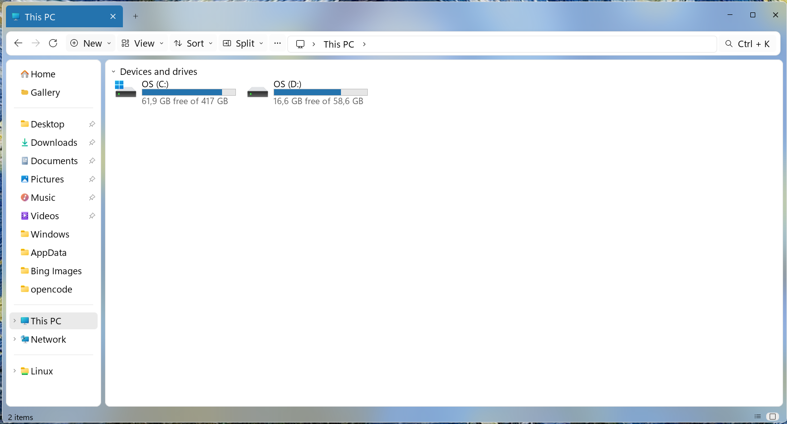
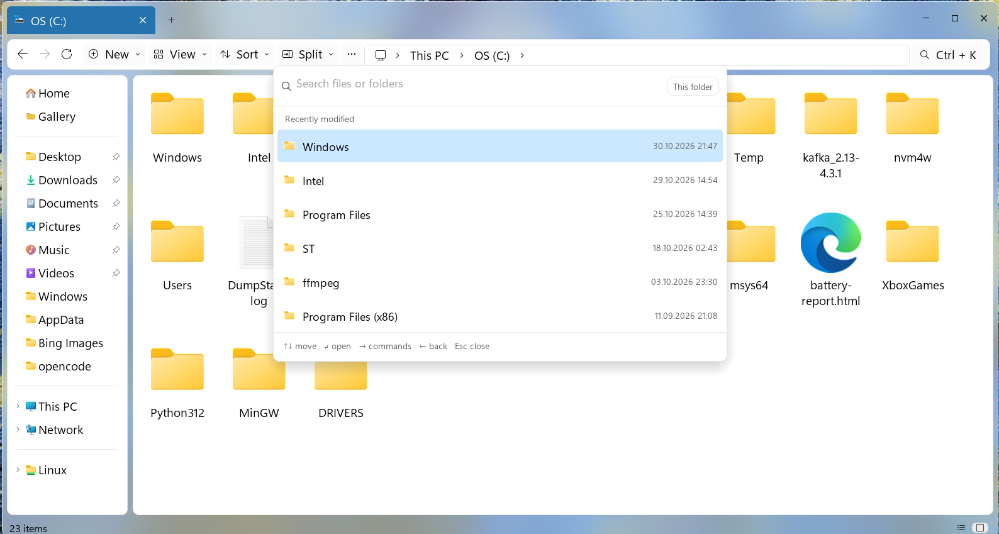
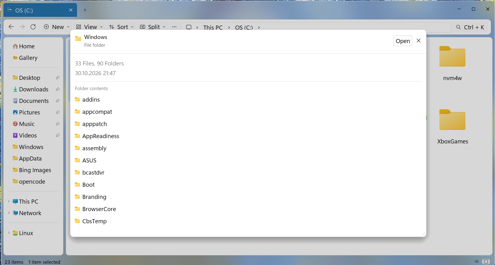

# StarFile Explorer

[](https://github.com/some-rao/starfile-explorer/releases)
[](LICENSE)

A Rust file manager for Windows and Linux that looks like Windows 11 File Explorer.

[](docs/screenshots/screenshot1.png)
[](docs/screenshots/screenshot2.png)
[](docs/screenshots/screenshot3.png)

## Downloads

| Platform | Artifiact | Size |
|----------|-----------|------|
| Windows | StarFile-Setup.exe | Installer |
| Windows | StarFile.exe | Portable |
| Linux | starfile-linux-x86_64 | Binary |
| Linux | starfile-linux-x86_64.tar.gz | Tarball |

👉 [Download v0.8.0](https://github.com/some-rao/starfile-explorer/releases/tag/v0.8.0)

## Install

**Windows**: Run `StarFile-Setup.exe`. Installs per-user (no admin needed).  
**Linux**: `curl -fsSL https://raw.githubusercontent.com/some-rao/starfile-explorer/main/install.sh \| sh`

## Features

- **Windows 11 look**: Tabs in title bar, acrylic window, Explorer-style toolbar
- **Command Palette** (Ctrl+Shift+P): Quick file search, command execution
- **Split View** (Ctrl+Shift+S): Browse two folders side-by-side
- **Quick Look** (Space): Instant preview of images, PDFs, text
- **Batch Rename**: Rename multiple files with patterns (`{name}`, `{n}`, `{date}`)
- **Zip Support**: Extract and create zip archives
- **Git Status**: Branch column shows repository state
- **Auto Updates**: SHA-256 verified, no manual downloads needed

## What it does

### Standard Features
- Full Windows Explorer keyboard shortcuts (Ctrl+T, Ctrl+W, F5, F1, etc.)
- Native Windows shell integration (icons, thumbnails, context menus)
- Background threaded folder loading (no UI freeze)
- Parallel folder search
- Recycle Bin integration with undo (Ctrl+Z)

### Linux Differences
- Icons from desktop theme
- App context menu (no Windows shell)
- D-Bus file manager integration

## Building

Requires Rust 1.82+:

```bash
cargo build --release
```

## Changelog

See [CHANGELOG.md](CHANGELOG.md) for version history.

## Credits

Based on [Swift Explorer](https://github.com/misutesu-desu/swift-explorer) by misutesu-desu.  
Licensed under [MIT](LICENSE).

---

**Supported languages**: English, Turkish, German, Spanish, French, Portuguese, Russian, Chinese, Japanese