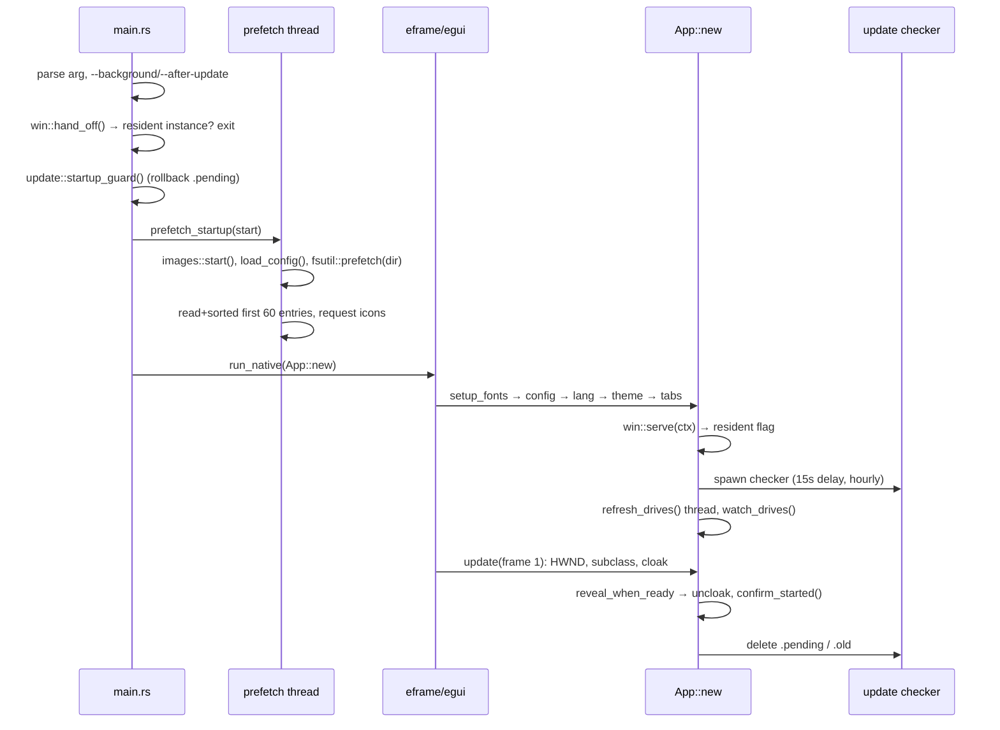
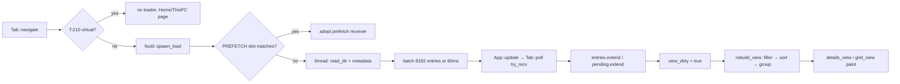
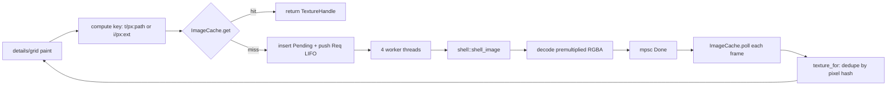

# Workflows & dataflow — Swift Explorer

End-to-end traces for every user-visible feature. Read
[`architecture.md`](architecture.md) first for the module/state model.

Legend: `A:` = `src/app.rs`, `T:` = `src/tab.rs`, `F:` = `src/fsutil.rs`, `I:` = `src/images.rs`,
`S:` = `src/shell.rs`, `W:` = `src/win.rs`, `U:` = `src/update.rs`.

---

## 1. Cold start → first painted frame



Key points:

- `hidden` (from `--background` / `--after-update`) makes the viewport inactive and suppresses the start
  path (`main.rs:28-41`), but the app still runs (updates, pipe server).
- First run (no `app.ron`) opens maximized (`main.rs:48`).
- `prefetch_startup` mirrors `Tab::rebuild_view` ordering on purpose (`A:168-217`); if you change sorting,
  grouping or hidden rules, update both or lose the warm cache.
- Window reveal is gated on: HWND known, at least one frame drawn, and `images.busy() == false` or 350 ms
  elapsed (`A:1256-1286`). `start_hidden` (login start) never reveals.
- `update::confirm_started()` runs once per process after reveal (`A:4341-4343`, `U:161-170`).

---

## 2. Second launch, resident process, background mode (Windows)

```
launch 2 ──open \\.\pipe\SwiftExplorer-<session>-<user>──► resident server thread (W:283-308)
             write u32 length + UTF-16LE path, AllowSetForegroundWindow
                                                    │
                            PARKED != 0 ? ──yes──► REOPEN = Some(path?) ; cloak; ShowWindow; SetForegroundWindow
                                          └─no───► reply 0 → launch 2 opens its own window
                                                    │
                        App::update → win::take_reopen() → App::reopen(start) (A:4322-4324, 1296-1309)
```

- Close with `resident && background` → `CancelClose` + `win::park(hwnd)` (`A:4331-4335`, `W:343-346`).
- Turning "Wait in the background" off (`A:2612-2626`) also turns autostart off; the next close exits.
- `update_installed` changes the close behaviour: launch the new build hidden and let this process exit
  (`A:4326-4330`).
- The updater calls `win::take_parked()` before relaunching, which disables further handoff for that process
  (`A:120-123`).
- Non-Windows: no resident mode, no handoff, no parking.

---

## 3. Navigation

Triggers and paths:

| Trigger | Code path |
|---|---|
| Sidebar / Home tile / drive card / breadcrumb | `Action::Navigate(path)` → `apply` → `Tab::navigate` (`A:1698-1709`, `T:191-258`) |
| Double-click folder / Enter on folder | `Action::OpenEntry` → navigate in place (`A:1719-1731`) |
| Address bar text | `expand_path()` (`A:3085-3125`) then `Navigate`; files are opened externally |
| Back / Forward / Up / Backspace | history vectors in `Tab` (`T:37-74`), root goes to This PC (`T:250`) |
| Middle click anywhere navigable | `Action::NewTab(path)` |
| Ctrl+N / tab menu | spawn `current_exe <path>` (`A:1752-1756`) |

`expand_path` supports `~`, `shell:desktop|downloads|personal|my pictures|appdata|local appdata|profile`,
any `%VAR%` (unknown vars stay literal), slash normalization and `C:` → `C:\` (`A:3085-3125`,
`T:93-102`). Relative input stays relative (resolved against the process CWD at open time).

Terminal shorthand: if the first word is `cmd|powershell|pwsh|wt|terminal` **and** the full typed text is not
an existing directory under the current folder, the address bar emits `Action::RunTerminal`
(`A:2315-2324`, `W:135-158`). Home and This PC use the user home as the working directory.

`Tab::navigate` clears search/entries/selection/groups, resets `filter`, then either becomes virtual
(Home/This PC: no loader), becomes Gallery (gallery scan, no watcher/free-space), or starts a load +
free-space query + watcher (`T:191-258`).

---

## 4. Directory listing pipeline (the hot path)



1. `spawn_load` (`F:324-347`): reuses the one-slot `PREFETCH` receiver only on exact path match; otherwise
   drops it (the prefetch worker's `send` fails and it exits).
2. Worker (`F:349-379`): `read_dir`; per entry `Entry::from_metadata` (name, lowercased name, dir flag from
   attributes, size 0 for dirs, optional times, hidden flag, lowercase extension, `plain_dir`); entries whose
   metadata fails are **silently skipped**; batches every 8192 entries or 60 ms and repaints.
3. `Tab::poll` (`T:375-417`) drains the channel. `progressive = true` (first open, `exit_search`) appends
   directly; `progressive = false` (watcher refresh) buffers into `pending` and `swap_in` on `Done`, so the
   old list stays visible (no flicker; `T:256-273`, `341-362`).
4. `rebuild_view` (`T:463-516`): filter by `show_hidden` + `Pattern(filter)`, sort with
   `fsutil::compare`, optionally group by date, then resolve `select_after_load`.
   Sorting >4000 items uses `rayon` (`T:473-479`).
5. Rendering: `view_level == 0` → `details_view` (`A:3446`, `egui_extras::TableBuilder`, fixed columns),
   otherwise `grid_view` (`A:3647`, manual virtualization, grouping headers inline).
6. Status bar counts come from `view.len()` vs `entries.len()` (`A:3944-4004`).

Errors: a top-level `read_dir` error arrives as `LoadMsg::Error`; with `progressive = false` the old list is
kept and `error` is shown (`T:396-415`). Accessibility: hidden/system entries are always **loaded** and only
filtered at view level.

---

## 5. Live folder updates (watcher)

1. On navigate, `Tab::watch` installs `notify::RecommendedWatcher` (`NonRecursive`) and keeps it alive in
   `Tab.watcher` (`T:275-294`). Any event except `Access` sends `()` and repaints.
2. `Tab::poll` coalesces events; first event arms `refresh_at = now + 120 ms`; if a loader is already running
   it waits (`T:419-438`).
3. On expiry: refresh free space, `load(false)` → non-progressive reload with `swap_in` name-based
   selection restore.
4. Watcher is not installed for virtual pages and is ignored while a search is active.
5. The **sidebar/breadcrumb subdir cache is not watcher-invalidated** — it only clears on Refresh and the
   View-menu hidden toggle (`A:1740`, `A:2597`).

---

## 6. Search

```mermaid
flowchart TD
  Q[palette query] -->|typing| F1[Tab.filter + view_dirty<br/>while a search is running]
  F1 --> F2[Pattern::matches in rebuild_view<br/>instant in-memory filter]
  Q -->|pick "show all results"| S1[Action::SetSearchScope + StartSearch]
  S1 --> S2[Tab::start_search: Pattern from filter]
  S2 --> S3[fsutil::spawn_search: roots = folder, subfolders or all drives]
  S3 --> S4[thread + nested rayon walk, batch per directory]
  S4 --> S5[Tab::poll: entries.extend, view_dirty]
```

- The toolbar has no search box. Ctrl+K (also Ctrl+E, Ctrl+F, F3) opens the command palette, which
  filters the current folder in memory as you type; the `;` / `;;` prefixes pick a wider scope.
- Picking **show all results** hands the query to the in-tab search page with the scope taken from
  that prefix (`palette.rs` → `Action::SetSearchScope` + `Action::StartSearch`).
- Pattern semantics (`F:170-219`): if the query contains `*` or `?`, the whole query is one glob over the
  lowercased name (spaces literal). Otherwise whitespace-separated words are AND-ed substrings.
- Search roots: current folder, or every drive root on This PC (`A:1918-1922`).
- The walker prunes symlink/junction subdirs (`DIR && !REPARSE`), silently skips unreadable dirs, has no
  depth/result cap, and counts scanned dirs in an atomic (`F:407-432`).
- Cancellation: `SearchHandle.cancel` + dropping the receiver (`T:320-324`); each directory checks the flag.
- Results are appended unsorted; the UI sorts them each rebuild. Date grouping is suppressed while searching
  (`T:481`). Details view adds a "folder" column with the path relative to the tab root (`A:3590-3599`).
- Exit: Esc, the search chip, Up/Backspace; `exit_search` either clears (virtual) or reloads the
  folder (`T:326-339`).

---

## 7. Selection, focus and keyboard

- State: `selection: HashSet<entry_index>`, `cursor`, `anchor` (`T:45-47`). `view` holds indices; selection
  survives sorting because it indexes `entries`.
- Click (`A:3326-3359`): plain = select only; Ctrl = toggle; Shift = range from anchor; double-click = open
  that entry; middle-click folder = new tab; right-click/drag on unselected = select it first.
- Keyboard (`A:1616-1666`): arrows move by `grid_cols` in icon views and by 1 row in details; PageUp/Down =
  `cols*4` or 20; Home/End use `isize` sentinels; Shift extends, Ctrl moves cursor only; Ctrl+Space toggles;
  any move sets `scroll_to_cursor`.
- Type-ahead (`A:1668-1688`): 900 ms buffer, prefix match on `name_lower`, repeated single character jumps to
  the next match, wraps around.
- Marquee (`A:3424-3443`): background drag draws a rect and selects intersecting `item_rects` (rebuilt each
  frame by both views).
- `selected_entries()` falls back to the cursor when the set is empty (`T:523-533`), and filters through
  `view`, so hidden/filtered selected items are dropped from operations.
- Home/This PC pages have no keyboard cursor navigation (`A:1550`).

Shortcut table: see [`low-level-design.md#19-shortcuts`](low-level-design.md#19-shortcuts). In-app F1 Help is the
source (`HELP`, `A:4236-4266`).

---

## 8. Clipboard (copy / cut / paste)

**Copy/Cut** (`A:1768-1779`):

1. `paths = selected_paths()`; `win::clipboard_set_files(paths, cut)` writes the OS clipboard.
2. `App.clipboard = Some((paths, cut))` remembers the snapshot for reconciliation.
3. Cut items are dimmed in both views via `cut_set` derived from the snapshot.

**Windows clipboard format** (`W:169-209`): CF_HDROP file list + registered `"Preferred DropEffect"` DWORD
(`DROPEFFECT_MOVE = 2`, `DROPEFFECT_COPY = 1`). Reading: file list, then effect; `cut` only when MOVE is set
without COPY.

**Paste** (`A:1782-1801`):

1. Refused on Home/This PC and during search (`busy_here`).
2. Prefer the OS clipboard; if its path list equals the remembered snapshot, OR in the remembered cut flag
   (Explorer sometimes rewrites the drop effect).
3. No files on the clipboard → non-Windows may still paste text as paths (`Event::Paste` +
   `win::note_paste_text`, `A:1457-1465`).
4. `start_transfer(files, current_dir, cut)`.
5. A successful cut paste clears the in-app snapshot; the OS clipboard may still advertise a cut.

Linux specifics: clipboard is newline-separated absolute paths; `clipboard_get_files` returns `None` if any
line is not an absolute existing path (`win_unix.rs:249-273`). Drag-out is not implemented.

---

## 9. Drag & drop

### Internal (egui DnD)

1. Item drag start → `DragAndDrop::set_payload(DragPaths(selected_paths))` (`A:3350-3355`).
2. Drop targets: tab labels, sidebar rows/tree nodes, Home tiles, drive cards, breadcrumbs, folder rows/tiles,
   empty file area (`A:2105`, `2795`, `2866`, `2962`, `3060`, `2431`, `3298-3311`, `3416`).
3. Drop emits `Action::DropPaths{paths,target,ctrl,shift}` (`A:1803-1812`):
   - reject if target == source parent, target == source, or target is inside a source;
   - Ctrl = copy, Shift = move, otherwise move when `same_volume(first_source, target)` (Windows: first path
     component; Unix: `st_dev`);
   - `start_transfer` (conflict check first).
4. Drag label + copy/move hint drawn by `drag_overlay` (`A:4064-4088`). No spring-loaded folders; only tabs
   auto-activate on hover (`A:2101-2104`).

### External → app

`raw.dropped_files` are copied (never moved, modifiers ignored) into the active folder if it is a real,
non-search listing (`A:4428-4436`). Hover draws a full-window accent frame + "drop to copy" hint.

### App → external (Windows only)

While a payload exists and the cursor is outside the window with the primary button down: clear payload,
`shell::drag_out(paths)` runs a **blocking** OLE `DoDragDrop(COPY|MOVE|LINK)` (`A:4483-4496`,
`S:391-421`), then `inject_release` synthesizes mouse-up events (`A:4510-4517`).

---

## 10. Copy / move job

```mermaid
flowchart TD
  A[start_transfer] --> B[fsutil::conflicts]
  B -- conflicts --> C[Dialog::Conflict<br/>Replace / Skip / Keep both]
  B -- none --> D[spawn_transfer]
  C --> D
  D --> E[thread per job]
  E --> F{same-dir cut? skip}
  E --> G[cut: try fs::rename → instant move + undo pair]
  E --> H[else: tree_size total, copy_tree]
  H --> I[syncing = true → sync_to_disk]
  I -- sync ok & cut --> J[delete source]
  I -- sync failed & cut --> K[keep source, no undo pair]
  J --> L[pairs → undo Moved/Copied]
  L --> M[UI: toast + optional "written to disk"]
```

Details:

- Conflict detection is name-based per top-level source, excluding same-folder pastes (`F:848-855`).
- `start_transfer` opens a single-choice modal for the whole batch (`A:1331-1342`, dialog `A:4126-4169`).
- Per source (`F:771-845`):
  1. self-copy guard is **lexical** `dest.starts_with(src)`;
  2. cut into the same directory is a silent no-op;
  3. target = `unique_destination` when pasting into the same folder, else conflict choice;
  4. `cut` tries `fs::rename` first — same-volume moves are instant and counted via `files`, not `done`;
  5. remaining sources: `total = Σ tree_size` (a second full traversal), then sequential `copy_tree`.
- `copy_tree` (`F:674-723`): skips reparse-point directories wholesale, `create_dir_all`, files <32 MiB use
  `fs::copy`, larger files use a 4 MiB buffer loop that deletes the partial file on cancel, restores
  `modified`, records every written path.
- `sync_to_disk` (`F:729-769`): Windows flushes every written file in parallel (`FlushFileBuffers` via
  `sync_all`, temporarily clearing read-only if needed); Unix uses one `syncfs` on the destination.
- Cross-drive move deletes the source **only after** the flush succeeds (`F:828-838`); a flush failure also
  skips the undo pair.
- Progress: `Job.total/done/files` atomics, `current` mutex, `errors` vec, `syncing` flag; UI cards in
  `overlays` (`A:4007-4062`) repaint every 100 ms; cancel disabled while syncing.
- Free space is displayed but **never** checked before copying.
- Errors are accumulated per item; the UI shows the first plus `(+N errors)` (`A:4400-4403`).

---

## 11. Delete and undo

| Action | Implementation |
|---|---|
| Delete (Recycle Bin) | `trash::delete_all(paths)` — all-or-nothing, no progress, no cancel (`F:903-907`) |
| Shift+Delete | `Dialog::ConfirmDelete` (Enter also confirms) → `spawn_delete(permanent = true)` (`A:4095-4125`), per-item remove, cancellable |
| Undo (Ctrl+Z) | LIFO `Vec<UndoOp>` (`A:1392-1432`) |

Undo journal (created when a job completes, `A:4392-4399`):

| `UndoOp` | Recorded from | Replay |
|---|---|---|
| `Rename{from,to}` | successful rename | rename back |
| `Created(path)` | new folder/file | delete to Recycle Bin |
| `Moved(pairs)` | cut transfer with pairs | rename back; fallback = grouped `spawn_transfer(cut)` when rename fails (cross-volume) |
| `Copied(dests)` | copy transfer | Recycle-Bin delete of the copies |
| `Trashed(paths)` | non-permanent delete | `restore_from_trash` |

- Jobs spawned by undo are marked silent by `Arc` pointer key in `silent_jobs`, so they never re-enter the
  journal (`A:1434-1440`, `4386-4389`).
- `restore_from_trash` matches by original parent + name **or file stem** (Explorer hides extensions) and
  picks the newest `time_deleted` (`F:858-882`) — same-stem files can restore the wrong generation.
- No redo, no persistence; permanent deletes are not undoable.

---

## 12. Rename / new folder / new file

- `F2` or menu → `Renaming{path,text,first}`; editing starts in the row/tile; first frame selects the stem
  (leading-dot files fully) (`A:3567-3584`, `3771-3789`).
- Commit on focus loss; Esc cancels. `commit_rename` (`A:1367-1390`): trim, reject empty/`.`/`..`/`\/:*?"<>|`,
  allow case-only rename, refuse existing target, `fs::rename`, push `UndoOp::Rename`, reload and reselect.
- New folder/file (`A:1344-1365`): no prompt; localized base names; `unique_destination` ("name - Copy",
  "name - Copy (2)") (`F:641-663`); create; push `UndoOp::Created`; reload; start inline rename when the new
  entry appears (`A:4357-4368`).

---

## 13. Context menus

Since the parity pass the default menus are **drawn by `menu.rs`** (Win11 look), not `egui::menu`.

| Surface | Menu |
|---|---|
| Item right-click | `App::item_menu` builds `menu::Menu` from the **shell verb tree** (`ShellMenu::build`) + app commands; allowlist keeps Explorer-like verbs, the rest live behind "Show more options" |
| Empty area right-click | `background_menu`: View, Sort, Refresh, Paste, Undo, New, Select all, terminal, pin, Properties |
| "Show more options" / Shift+F10 / Shift+right-click (Windows) | `Action::ShellMenu{extended}` → native `IContextMenu` (`A:1883-1895`, `S:343-387`) |

Native menu: PIDLs via `SHParseDisplayName`, `IShellItemArray` → `BindToHandler`, `QueryContextMenu`
(`CMF_NORMAL|CMF_CANRENAME`, plus `CMF_EXTENDEDVERBS`), `TrackPopupMenuEx` at cursor. Only the `rename`
verb is intercepted and mapped to inline rename. Menu messages are forwarded through the subclass, and
`inject_release` clears egui's stuck mouse state afterwards.

`menu::show` returns `Outcome::{Command,Close}`; `Cmd::App` maps to `Action`, `Cmd::Shell` invokes a verb,
`Cmd::More` opens the native menu. Submenus are `Node.children`; icons come from `g::` glyphs with
`fluent_font`. There is **no** Win11 XAML menu API for third parties, hence the custom renderer.

---

## 14. Icons & thumbnails



- Keys: `i{px}:<klasör>` shared for plain dirs, `i{px}:{path}` for dirs/extensionless/per-path types
  (exe, lnk, ico, url, cur, ani, msc, cpl, scr, appref-ms, website), `i{px}:.{ext}` shared per extension,
  `t{px}:{path}` for thumbnails (`A:957-980`, `3755`).
- `px_bucket` snaps to 16/24/32/48/64/96/128/256/512 after multiplying by the monitor scale.
- Windows icon production: `IShellItemImageFactory::GetImage` with `SIIGBF_BIGGERSIZEOK` (+ `ICONONLY`),
  HBITMAP → 32-bit BGRA → RGBA with premultiplication heuristics (`S:49-121`). All thumbnails (images,
  video, PDF, Office) are the shell's, so installed handlers decide coverage (`F:950-957`).
- Linux: icon theme lookup (`freedesktop-icons`), SVG via `resvg`, raster via `image::thumbnail`; no video/PDF
  thumbnails (`shell_unix.rs:17-128`).
- Workers: 4, LIFO queue (newest visible rows first), 3 attempts then icon fallback (`I:72-117`).
  For still images, if the shell returns no thumbnail, `decode_photo` decodes png/jpg/gif/webp/bmp/tiff
  locally (≤48 MB) before falling back to the icon — this is what makes Gallery thumbnails reliable.
- Cache: 160 MiB of deduped texture bytes (`ahash` of pixels shares identical textures), LRU eviction in
  chunks of 64 down to 75 % budget; anything drawn in the current/previous frame is never evicted (`I:159-317`).
- `drop_pending()` is called on navigation; `busy()` gates the startup reveal.
- Known issue: a slot stuck in `Pending` is never retried or evicted; the icon stays blank for the session.

---

## 15. Quick Look (preview surface)

The preview and details panes were removed; Quick Look (Space) is the only preview surface and it
already follows the list selection while it is open.

- Open: Space (or Ctrl+Space) on the highlighted entry, or the `Peek` action; `App.quick_look` picks the
  mode — 0 built-in overlay, 1 PowerToys Peek, 2 off.
- Overlay: a dimmed scrim plus a draggable, resizable rounded card with a title row (icon, name,
  type · size, Open / Open with… / Close). Esc, a scrim click or Close dismisses it.
- Body by kind: folders list their contents with counts; PDF / video / audio / HTML go to the embedded
  WebView2 player (`webview::Want`); Markdown is rendered through `markdown.rs`; plain text and code are
  syntax-highlighted; anything else falls back to a metadata block.
- Text preview: background thread reads 64 KiB; UTF-16LE BOM decoded, a NUL byte in the first 8 KiB means
  binary, else UTF-8 lossy (`F:967-987`). The slot lives on the `QuickLook` value, so closing the overlay
  drops it (`A:495-507`, `5798-5812`).

---

## 16. Settings, theme and language changes

| Change | Effect |
|---|---|
| Toggle hidden / extensions / view | mutate `App`, mark views dirty (hidden also relabels the group set) |
| Sort / group | global; `Action::Sort` marks **all** tabs dirty (`A:1924-1932`) |
| Theme | `apply_theme(ctx, accent, theme)` immediately; persisted index (`A:2643-2647`) |
| Language | `apply_lang`, recreate `known`, clear `type_names`, refresh drives, mark views dirty (`A:2657-2661`) |
| Background/autostart | registry values on Windows; disabling background disables autostart (`A:2612-2627`) |
| Auto-update | atomic bool read by the checker thread; persisted |

Persistence: `save_config` (`A:1177-1209`) serializes the whole `Config` and writes only when changed;
autosave every 3 s, on park, on bookmark change and on exit.

---

## 17. Self-update

1. **Check** (`A:102-149`): 15 s after start, then hourly (±10 min jitter), also when woken by window reopen.
   Persisted `last_update_check` prevents hammering; a clock going backwards triggers a check.
   `update::enabled()` is false for Flatpak (`FLATPAK_ID`), Scoop installs, and debug builds under `target/`.
2. **Manifest** (`U:11-36`): `…/releases/latest/download/latest.json`
   `{version, page, windows:{url, sha256}}`; version compare is numeric-only (`U:38-45`).
3. **Install** (`U:172-209`), only on Windows and only if enabled:
   download to `<exe>.new` (≤256 MiB) → SHA-256 while streaming → `sync_all` → compare (case-insensitive) →
   `rename(exe → exe.old)` → `rename(new → exe)` (restore `.old` on failure) → write `.pending = "0"`.
   `PermissionDenied` (Program Files) degrades to "update available".
4. **Rollback guard** (`U:122-158`): each start increments `.pending`; after 2 starts without
   `confirm_started`, the exe is moved to `.bad`, `.old` restored, `.skip = version` written, and the old
   build relaunched.
5. **Apply**: with the window parked and no jobs running, the checker spawns `--after-update` and exits; the
   new process waits up to 5 s for the old pipe to disappear and starts hidden (`A:119-127`, `main.rs:31-39`).
   Otherwise a toast asks the user to close the window.
6. **Cleanup**: `confirm_started` removes `.pending`; `remove_old` deletes `.old`/`.bad` when no `.pending`.

---

## 18. Release flow

1. Bump `Cargo.toml` version, add an AppStream `<release>` entry, commit.
2. Tag `vX.Y.Z` and push; CI builds Windows (MSVC) + Linux, packages, attaches artifacts.
3. `manifest` job derives the version from the tag (not `Cargo.toml`), hashes `SwiftExplorer.exe`, writes
   `latest.json`, attaches it.
4. Flatpak jobs regenerate `cargo-sources.json` from `Cargo.lock` and build `swift-explorer.flatpak`.
5. Scoop bucket bumps are external.

---

## 19. Symptom → where to look

| Symptom | Likely cause / place |
|---|---|
| Window never appears (Windows) | cloak never removed: HWND not captured or `images.busy()` stuck (`A:1256-1286`, `I:236-238`) |
| App exits instantly on second launch | stale pipe/`hand_off` mismatch (`W:236-274`) or `--after-update` timeout (`main.rs:31-39`) |
| Folder list empty, no error | all metadata reads failed, or virtual path sentinel (`F:349-379`, `T:174-186`) |
| List flickers on refresh | `progressive` should be `false` for refreshes (`T:256-273`) |
| Icons blank / never load | pending slot stuck, shell handler crash, queue purged (`I:199-211`, `242-253`) |
| Copy seems done but USB unsafe to remove | `syncing`/`sync_to_disk` path (`F:821-827`) |
| Ctrl+Z does nothing after move | sync failed → no undo pair (`F:828-839`) |
| Sidebar tree stale | `subdirs` cache not invalidated (`A:1982-2005`) |
| Wrong language strings | `apply_lang` ordering / missing table keys (`A:576-584`, `i18n.rs:495-503`) |
| Update loops or won't start | `.pending`/`.old`/`.skip` next to the exe (`U:111-170`) |
| Menu leaves mouse stuck | missing `inject_release` after native menu/OLE (`A:1883-1895`, `4510-4518`) |
| One-frame lag on actions | by design: `Action` queue applied at end of frame (`A:4498-4500`) |
| Gallery empty or raw CLSID shown | wrong Gallery CLSID, `is_gallery()`/`is_home()` guard, `tab::GALLERY` mismatch (`T:16-27`, `F:spawn_gallery`) |
| Gallery preview says "select an item" | gone: Quick Look previews the highlighted entry (`preview_body`) |
| Gallery sort menu does nothing | intentional: Gallery forces modified-desc in `rebuild_view` |
| WSL node missing | `wsl.exe --list --quiet` failed/empty, 10 s cache, or non-Windows build (`wsl.rs`) |

---

## 20. Explorer-parity additions (2026)

These were added after the 0.7.0 docs pass; line anchors in sections 1-19 may have shifted.

| Feature | Flow |
|---|---|
| **System scaling / font** | `system::text_scale()` → `ctx.set_zoom_factor`; Segoe UI Variable; PerMonitorV2 manifest; `system::animations_enabled()` gates motion |
| **Window chrome** | first frame: `system::set_hwnd(hwnd)` + `system::apply_backdrop(hwnd)` → DWM rounded corners (`DWMWA_WINDOW_CORNER_PREFERENCE`) and immersive dark frame. Mica is *not* used: eframe's glow surface presents opaque |
| **Modern context menu** | right-click → `ShellMenu::build` → allowlisted `menu::Node` tree → `menu::show`; "Show more options" → native classic menu (see §13) |
| **Gallery** | sidebar row → `GALLERY` sentinel → `fx::spawn_gallery` (Pictures tree, images+videos, 5000 cap) → forced modified-desc + month/year groups → Quick Look works; search roots = Pictures |
| **WSL** | `wsl::distros()` (UTF-8/UTF-16LE, 10 s cache) → "Linux" sidebar node → `\\wsl.localhost\<distro>` through the normal directory pipeline |
| **Installer** | `packaging/windows/swift-explorer.iss`: per-user Inno Setup, Start Menu shortcut, optional desktop shortcut, AUMID `SwiftExplorer.App`, uninstaller; `swift-explorer.exe --uninstall-cleanup` removes autostart/registry leftovers. Self-update and portable zip stay supported |
| **New submenu** | `newfile.rs` templates (`Action::New(index)`); separate contribution, same menu renderer |

Verification harness (feature `screenshot`): `SWIFT_EXPLORER_SCREENSHOT`, `_DELAY`, `_SIZE=1280x800`,
`_INPUT="click:x,y;hover:x,y;rclick:x,y"`. Coordinates are **egui points**; the BMP may be DPI-scaled.

